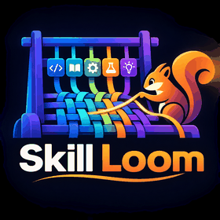
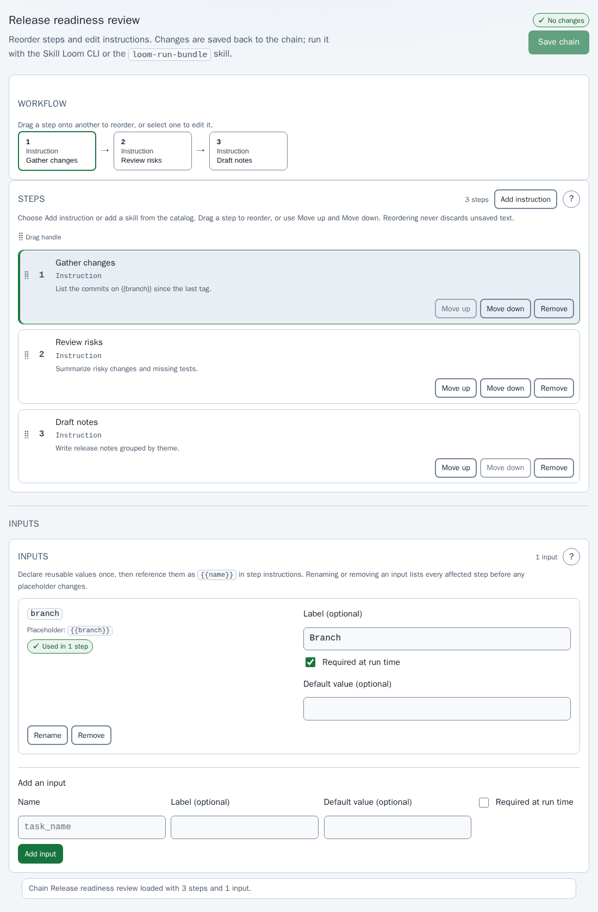

I have a lot of installed agent skills. I do not want all of them active at once. I want to browse them, pick the ones that fit the job, put them in a specific order, and reuse that order next time. Sometimes I want the same skill twice with different instructions.

That was the original idea behind Skill Loom: a way to weave separate skills into one repeatable chain, apply that chain to a project, and run it in the current agent session.

The first version was a UI. That was the wrong center of gravity.

<!--more-->

## The original idea

Skill Loom started with a small annoyance. Skills were spread across local repositories, global installs, and harness-specific folders. A chain was more than a list of names. It had an order, inputs, handoffs, and a target project.

I wanted to browse the available skills, search them, add the ones I needed, and move them into the right order. Then save the chain. Then apply it to a repository, copying any missing skill into the project. Then run it. The same chain should work again next week, and ideally in another repository or harness.

The appeal was bigger than saving a few clicks. It was the possibility of a shared source of truth. A chain could become a reviewed workflow that another person, or another agent, could pick up and use.

## The UI-first mistake

I built the screens first. Projects, catalogs, discovery, libraries, runs, and a terminal. It looked like a product. It behaved like a second place to do the work.

The more I used it, the more confusing it became. If it was confusing to me, it would be worse for anyone else. I was managing chains as web screens instead of letting the agent use the CLI and the skills in the current session. That was the wrong habit, and it was pulling the design away from what I actually wanted.

It also pointed away from a centrally managed source. Local screens keep the workflow on one machine. A team needs a shared source. If the chain lives in a UI, the UI becomes the thing people have to learn before they can use the chain.

The UI was also constraining the product. I was designing what fit on a screen instead of what the workflow needed. Once I saw that, it changed what Skill Loom could be.

## The pivot

The workflow moved to a CLI and a set of companion skills. The agent does the work. The CLI owns the catalog, the shared chain library, preflight, project application, and runs. The only web screen left is the chain editor, because reordering steps, editing instructions, and managing inputs benefit from a visual surface.

Two decisions did most of the work.

The first was to run chains in the current agent session instead of launching a nested harness. The agent already has the context, the project, and the conversation. A chain should use that context instead of starting a separate harness session.

The second was to standardize skills in `.agents/skills`. Most harnesses understand that location. Each harness still has its own way of telling the agent to run a prompt. That is the only harness-specific part. The skills themselves are portable.

The shared chain library and the host-global catalog became the source of truth. Repo-first chains keep a canonical `chains/<id>.json` file in the repository. The shared library makes a chain visible from every registered project. The hosted Podman path extends that source to trusted remote clients without exposing the HTTP service.

## What it is now

The loop is simple to describe:

```text
discover -> chain -> apply -> run -> edit or publish
```

**Discover.** The `scenario-discovery` skill starts with an outcome, expands it into capability queries, searches the catalog and capability index with declared metadata filters, reranks a shortlist, reads the selected packages in full, and proposes up to three chains. It does not run them. This is the part that turns “I have skills” into “here is a workflow worth trying.”

**Chain.** A chain has ordered steps, instructions, named inputs, and a target harness. It can live in the shared library or in the repository as a tracked chain file. Publishing a repository chain is revision-checked, so an update cannot silently overwrite a newer shared version.

**Apply.** Applying a chain copies only the skills it references into the project’s `.agents/skills/` directory. It never overwrites an existing package. Missing, ambiguous, or partial copies are reported as errors.

**Run.** The chain runs in the current session. Preflight blocks a missing or disabled skill before the first step. The harness decides whether to load a named skill, and the system records a skill-loaded signal only when the harness exposes one.

**Edit or publish.** The chain editor is the only web screen. It shows the workflow, the step list, and the inputs, and writes changes back to the draft or project chain. The CLI and companion skills handle everything else.

The example scenarios were the proof that this composition works. A business performance review combines `minimax-xlsx`, `data-storytelling`, and `pptx-generator`. A student revision pack combines `pdf`, `scientific-critical-thinking`, and `pptx-generator`. A web app MVP combines a framework skill with `playwright-expert`. A browser game prototype combines `phaser` with `playwright-expert`. The skills come from different authors and repositories, but the chain is one ordered workflow.



The screenshot is the editor on a demo chain. It is the only screen in the product.

## The evidence

A chain is only real if the harness actually uses the skill. In the sessions I monitored, the harness reported each skill loaded. That was the signal I needed. It is stronger than a plausible-looking answer, and it is stronger than the fact that the skill happened to be installed.

The install-if-missing step removes one failure mode before the run starts. The skill-loaded event shows that the harness reached for the skill during the run. The docs still keep the conservative boundary: chain order is prompt order, and a harness may decline to load a named skill. I am not claiming every harness will behave the same. I am claiming that in the sessions I watched, the skills fired, and the system made that observable.

## The hard part

Harness differences were the hard part. Each harness has its own skill locations, its own discovery rules, and its own way of running a prompt.

The generic `.agents/skills` convention removed most of that. The remaining harness-specific layer is small: how you tell the agent to run the prompt. That keeps the difference in one place. The skills stay portable, and the chain order stays explicit.

Discovery was the second hard problem. A search result is not a chain. The capability index proposes candidates, the agent reads the full packages, and the shortlist gets reranked against the outcome. The index only suggests candidates. The agent selects after reading them.

## What it enables

Repeatability is the first win. Save a chain once, apply it to another project, and get the same ordered workflow.

Composition across sources is the more interesting win. A chain can combine skills from different authors and different repositories without vendoring them into one giant package. The chain becomes the unit of reuse, not the skill folder.

For a team, the shared source of truth is what makes the workflow portable. One host can hold the catalog and the chain library, and trusted remote clients can reach it over SSH-backed Podman. The service stays loopback-only. The remote path is the extension, not a public API.

The current limits are real: one harness per chain, no per-step harness or model switching, and managed automatic execution still blocked behind containment and verification work. The package is `0.1.0` and private, with no registry release. I would rather ship a smaller system with visible edges than a larger one that pretends those edges do not exist.

## What comes next: Foundry

The next step is Foundry, a private Azure-hosted experiment for sharing chains with Foundry and Copilot clients. The caller executes the chain. The service is about discovery and reviewed catalog and chain snapshots, not running the work for the client.

Foundry has local API, authentication, persistence, and catalog foundations. It does not have a deployed HTTP or MCP service yet. The point is to take the shared source of truth from one host to a service a team can use. That work is still local. Nothing is deployed.

## What I would do differently

Build the library and the CLI before the UI. The UI was the first thing I built, and it was the thing that made the product harder to understand.

Standardize the skill location early. The `.agents/skills` decision removed a whole class of portability problems.

Keep the harness glue thin. If the only harness-specific piece is how to run the prompt, the rest of the system can travel.

Treat the UI as a tool for the one job that needs it. The chain editor is useful because ordering and inputs are visual. The rest of the workflow does not need a screen.

Test in the session. A model that can describe the chain is not the same as a harness that loads the skill. The skill-loaded signal is the evidence that the chain ran the skills.

## The repo

Skill Loom is still early. There are 352 commits and 35 ADRs behind the current shape, and plenty of gaps listed in the repository. But the loop works: discover a chain, apply it, run it in the current session, and keep the source of truth shared.

That is a better product than the one I started with. It is also a smaller one.

The source is at [github.com/McFuzzySquirrel/skill-loom](https://github.com/McFuzzySquirrel/skill-loom). The scenario examples are in the [scenario chain guide](https://github.com/McFuzzySquirrel/skill-loom/blob/main/docs/scenario-chains.md). The decisions are in the [ADR directory](https://github.com/McFuzzySquirrel/skill-loom/tree/main/docs/adr).
