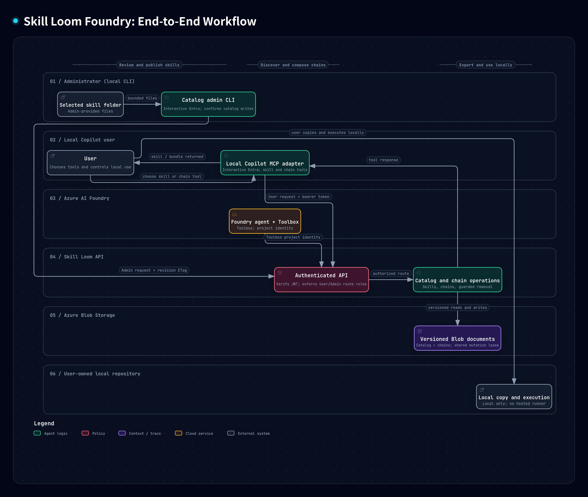
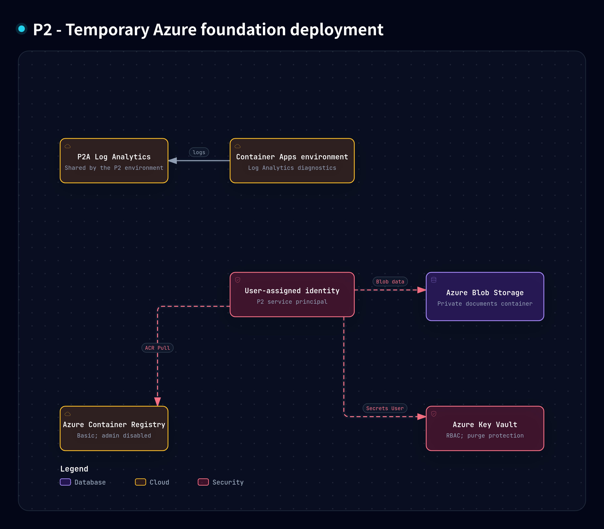
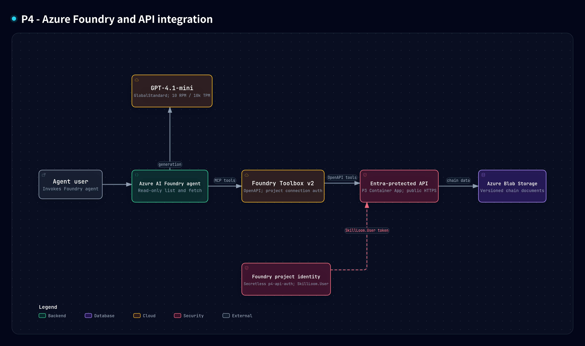

This is going to be an interesting one, and I documented the work as we went. I ran the experiment with GitHub Copilot CLI: I brought the project idea and made the decisions; Copilot helped with research, planning, implementation, and checks. I also called out the steps I handled myself, like tenant and account setup, alongside the work we did together.

Super important note: to test this out starting from zero, I created a brand new Azure tenant with nothing in it other than my user account.

<!--more-->

Everyone knows (or should know by now) that agent skills are valuable and versatile in the projects we take on, whether they are custom skills we create for our own needs or focused skills for a particular task.

What a lot of people may not know is that, alongside community-contributed skills, agents, and plugins, product and service providers are also publishing skills for working with their products. I have included a short list of some of them at the end of this article, but today I am focusing on the [Microsoft Azure Skills](https://github.com/microsoft/azure-skills). If you have not used them before, you may be missing out.

I wanted to test these skills against an idea that follows one of my usual routes: plan, spec, implement. This time, I brought Microsoft Azure Skills into the process from the beginning. The experiment was to take my existing [Skill Loom](/blog/skill-loom/) ([repository](https://github.com/McFuzzySquirrel/skill-loom)), which currently runs on-device or in a hybrid, Podman-hosted setup, and build a separate Azure-hosted service around it, with Microsoft Foundry as one of the main components.

Why start small? Let's make this a worthwhile experiment with a real proof-of-concept solution at the end of it all.

Skill Loom is the pre-built solution I used as the target. Today it is a single-user workspace for building shared chains from skills already installed in a host-global `.agents/skills` directory. Its CLI and companion Agent Skills find and save ordered workflows, copy selected packages into a project when needed, and run steps in the current agent session. The only web screen is a visual chain editor, opened with `skill-loom edit`. Podman can host a persistent service; trusted remote CLI clients use SSH-backed Podman without exposing the Skill Loom HTTP service. Exported bundles remain a compatibility feature.

Moving that concept to Azure meant touching a lot of services: Entra ID app registrations and roles, Blob Storage, Container Apps, Container Registry, Key Vault, Log Analytics, Microsoft Foundry, and MCP integration. That gave the Azure Skills plugin a real workout across multiple services instead of a toy hello-world deploy.

## The setup

Before starting the planning phase, I wanted the basics covered:

- GitHub Copilot CLI
- The Microsoft Azure Skills plugin installed globally
- A dedicated project repository, started privately as `skill-loom-foundry` and later published as an audited public snapshot at [`McFuzzySquirrel/skill-loom-azure`](https://github.com/McFuzzySquirrel/skill-loom-azure)
- A brand new Azure tenant
- A running and recorded collaborative dialogue between me and the Copilot CLI agents. Sorry, a what? I imagine you saying.

The repository is the proof for this experiment. It is separate from the existing Skill Loom project: the goal was not to expose or reconfigure Skill Loom's local-trust server, but to build a new cloud service with its own authentication, storage, and hosting model.

## The running collaborative dialogue

Initially the idea was to record this for myself, but it turned out to be a good way to show how the plan was executed, like a cross between an engineering log and session notes. What mattered most to me was that the dialogue clearly separated where I stepped in from what the agent did, and recorded which skills and tools were used and when.

The full running dialogue grew to over 3,800 lines in the repository ([read the full session dialogue on GitHub](https://github.com/McFuzzySquirrel/skill-loom-azure/blob/main/docs/articles/azure-skills-experiment.md)), so this post pulls out the highlights, the real-world snags, and the phase-by-phase story.

## The plan

I usually start projects in plan mode, using something like GitHub Copilot CLI, VS Code, or OpenCode. For this one, Copilot CLI and I used plan mode to turn the idea into a phased implementation plan before provisioning an Azure Landing Zone and the rest of the Azure resources.

Working through the plan together drew a clear boundary. The first milestone is to serve chains and reviewed skills through an authenticated API and MCP layer, so Foundry and Copilot agents can retrieve and use them while running the steps in their own sessions. A hosted runner that executes chains in Azure is a later phase, not part of the first slice.

The plan also separates the new service from the existing Skill Loom codebase. The cloud project owns its schemas internally, and compatibility is checked at the exported chain and bundle formats using pinned fixtures. There is no shared published schema package, and the original Skill Loom project was not changed.

You can view the implementation plan here: [docs/plans/implementation-plan.md](https://github.com/McFuzzySquirrel/skill-loom-azure/blob/main/docs/plans/implementation-plan.md).

## The highlights

Let's cut to the chase. Starting from an empty Azure tenant, the experiment reached a working, live-validated proof of concept across project setup, Foundry landing zone, storage foundation, authenticated API, and Foundry/Copilot MCP integration.

Both clients completed live `list`, `get`, `save`, and `export` operations against the deployed Entra-authenticated Azure Container Apps API and Blob Storage. On the Foundry side, a prompt agent talked to the API through a Foundry Toolbox backed by a User-scoped OpenAPI contract. On the Copilot CLI side, a local Python stdio MCP adapter handled delegated MSAL interactive browser auth.

Every API call requires a Microsoft Entra ID v2 token with strict tenant, issuer, audience, and app-role checks (`SkillLoom.User` vs. `SkillLoom.Admin`). There are no API keys and no hosted execution. Chain content is treated as untrusted data and executed only in the caller's session.

Along the way, the skills and live checks caught several real Azure snags: an overly broad Foundry role assignment, an `arm64` vs. `amd64` Container Apps image mismatch, a Container Apps `ScheduledForDelete` state after CLI teardown, an Entra v1/v2 token mismatch, and Entra Security Defaults blocking device-code flow (`AADSTS530035`).

Finally, using `azure-app-onboard`, we added a standalone `azd`/Bicep deployment path and a local Docker/Azurite profile so anyone can try the repository without recreating my original working environment.

### Microsoft Azure Skills used across phases

| Phase | Azure Skills invoked | What they covered |
| --- | --- | --- |
| Foundry landing zone (P2A) | `microsoft-foundry`, `azure-quotas`, `entra-app-registration` | Quota checks, Basic Foundry provisioning, Entra app roles, smoke check, and teardown verification. |
| Storage foundation (P2) | `azure-storage`, `azure-quotas`, `azure-resource-lookup`, `entra-app-registration`, `azure-prepare`, `azure-validate`, `azure-deploy` | Storage backend comparison, Bicep validation and what-if, live Blob conditional writes, and encrypted backup/restore. |
| Authenticated API (P3) | `azure-storage`, `entra-app-registration`, `azure-prepare`, `azure-validate`, `azure-deploy` | Container Apps deployment, managed-identity RBAC verification, v2 token alignment, and live API checks. |
| Foundry and Copilot integration (P4) | `microsoft-foundry`, `microsoft-docs`, `entra-app-registration`, `azure-prepare`, `azure-validate` | OpenAPI Toolbox registration, project managed-identity connections, prompt-agent wiring, and telemetry diagnostics. |
| Adopter deployment path | `azure-app-onboard` | Designing and statically validating a fresh-environment Azure and local Azurite path. |

Alongside the Azure Skills, we leaned on `research`, `tdd`, `diagnosing-bugs`, `codebase-design`, `wizard`, `writing-for-agents`, `create-project-documentation`, `no-ai-slop`, `project-execution-journal`, and `archify` for the architecture snapshots.

## How it all panned out

Here is the condensed story of each phase from the collaborative session notes.

### Project setup, decisions, and interchange (P0/P1)

The first two phases set up the guardrails before touching Azure. The repository got its governance and contribution basics, architecture decision records, a CI workflow, and a pull-request template. The plan also recorded an accepted limitation: branch protection could not be enabled for the original private repository on its GitHub plan, so I chose to proceed without it (yeah, yeah, I know).

On the code side, we built the internal Zod schemas for chains, bundles, catalog entries, and run records, and pinned export fixtures from Skill Loom so compatibility is verified at the interchange boundary rather than through a shared package.

### Foundry landing zone (P2A)

From a blank tenant, I chose the Basic Microsoft Foundry setup, picked an available model and region, set up an advisory subscription budget alert, and created separate normal-user and administrator test identities.

Copilot checked provider and quota availability, provisioned the pinned landing-zone template, registered the single-tenant API app with `SkillLoom.User` and `SkillLoom.Admin` roles, and ran a tool-free smoke prompt using Entra authorization with no API key. One early catch paid off immediately: the normal test caller initially had a broader account-scope role, so Copilot added and verified the tighter project-scoped assignment and removed the broader one.

To prove repeatability, I authorized a full teardown (`azd down` plus purging the soft-deleted Foundry account) and verified the API registration and budget remained intact while the deleted Foundry identity's role assignment was gone.

### Azure foundation and storage (P2)

Next came persistence. A research sub-agent compared Azure Blob Storage against Azure Files and recommended Blob with ETag conditional writes. The sub-agent's first note misstated Azure Files' NFS rename support; the coding agent checked Microsoft's official protocol table and corrected the note before we locked in the decision.

I selected Blob Storage as the only PoC backend, set a 32 MiB serialized-object cap, and kept backup/restore manual for the cost-first PoC. After a live Blob spike confirmed container-scoped Entra RBAC and conditional writes, I authorized a temporary Bicep foundation deployment, synthetic encrypted backup/restore test, and teardown.

That teardown surfaced a useful operational lesson: the Azure CLI reported deletion success, but the Container Apps environment was still sitting in `ScheduledForDelete`. Checking the exact ARM resource ID afterwards, rather than trusting the CLI exit code, confirmed when it finally reached `ResourceNotFound`.

### Authenticated API in serve mode (P3)

Phase 3 built the Node.js/TypeScript HTTP API: an OpenAPI 3.1.1 contract, `jose`-based Entra JWT verification with per-operation role checks, versioned Blob persistence with conditional revisions, an Admin-reviewed skill catalog with pinned bundle snapshots, bounded request/query/body limits, and JSON-lines audit logs that strip tokens, paths, raw subject IDs, and skill bodies.

Locally, 36 tests and a non-root Podman container (`10001:10001`) passed. Deploying to Azure Container Apps brought two real-world surprises.

First, my host is ARM64, so the first container image pushed to ACR was `linux/arm64`. Container Apps requires `linux/amd64`, and the first revision failed. Switching the Dockerfile to build for `$TARGETPLATFORM` and rebuilding for AMD64 brought the revision up healthy, which also proved managed-identity image pull from private ACR worked.

Second, live Entra validation hit `AADSTS65001` (missing consent), `AADSTS700016` (client lookup in tenant), and a token-version mismatch where the client received a `ver: 1.0` token while the API enforced v2 issuer validation. Updating the API app registration with `--requested-access-token-version 2` and aligning the audience parameter fixed it.

Once aligned, live HTTPS checks passed end to end: `204` on liveness/readiness probes, `401` on anonymous and wrong-audience requests, `200` on authenticated `/v1/health`, `201` with ETag `"1"` on chain creation, `412` on stale-revision updates, `404` on encoded traversal lookups, and `413` on oversized request bodies.

### MCP server and Foundry/Copilot integration (P4)

Phase 4 was the hardest part of the experiment because two very different clients, Microsoft Foundry and GitHub Copilot CLI, needed to talk to the same authenticated API cleanly.

For Microsoft Foundry, I chose a Foundry Toolbox backed directly by a User-role-filtered version of `docs/openapi.json` (excluding Admin-only catalog mutations) authenticating to the API with the Foundry project's managed identity. Getting live execution across the line took patient debugging: assigning project-scoped `Foundry User` roles, tuning pay-as-you-go model throughput, fixing OpenAPI save-schema details across Toolbox revisions, and updating the smoke agent prompt so it stopped synthesizing invalid chain `agent` metadata. On the final authorized run, API audit logs confirmed `listChains`, `getChain`, `saveChain` (with `If-Match: "1"`), and `exportChainBundle` all returned HTTP `200`, and a read-back verified revision `2` in Blob Storage.

For GitHub Copilot CLI, pointing Copilot directly at the Foundry Toolbox hit OAuth metadata discovery issues, so we built a local Python stdio MCP adapter with MSAL delegated authentication. We first tried device-code flow and immediately hit `AADSTS530035` (`BlockedBySecurityDefaults`). Rather than weakening the blank tenant's Security Defaults, I approved switching to MSAL interactive browser authentication with PKCE and an `http://localhost` redirect. That unlocked live Copilot CLI `list`, `get`, `save`, and `export` calls straight away.

We also added a local admin CLI for managing the reviewed skill catalog. During a concurrency review, we spotted a race between chain writes and catalog skill removal. Rather than leaving it as a known bug, we implemented a renewable shared Blob lease to serialize chain mutations and removal scans across API replicas. In-memory concurrency tests pass; live Azure lease testing remains explicitly marked `not run`.

### What stayed deferred and publishing cleanly

After reviewing how a hosted runner would authenticate Copilot CLI jobs in Azure, I deferred hosted execution (P5) and kept my personal account local. Hardening, threat modeling, and a named-user pilot (P6) also remain post-POC.

Before making anything public, we ran `azure-app-onboard` to add a standalone `azd`/Bicep adopter deployment and a local Docker/Azurite profile, then ran a full release audit: Gitleaks secret scans, OCR checks on architecture diagrams (which caught and withheld one screenshot with a tenant-like label), and a fresh root-commit snapshot pushed to [`McFuzzySquirrel/skill-loom-azure`](https://github.com/McFuzzySquirrel/skill-loom-azure) while keeping the original working repo private.

## Try it in your own dev tenant

If you want to see how this works for yourself, you can provision the POC in your own Azure dev tenant (or run it locally with Docker Compose and Azurite first, with Foundry kept optional). The repository includes the deployment path and the documentation needed to get going and operate it:

- [Deployment guide](https://github.com/McFuzzySquirrel/skill-loom-azure/blob/main/docs/deployment.md) for standing up a fresh Azure environment with `azd` and Bicep, or running the local Azurite profile.
- [User guide](https://github.com/McFuzzySquirrel/skill-loom-azure/blob/main/docs/user-guide.md) covering client setup, Entra identity boundaries, and working with chains and skills through Copilot CLI or Microsoft Foundry.
- [Admin guide](https://github.com/McFuzzySquirrel/skill-loom-azure/blob/main/docs/admin-guide.md) covering catalog curation, roles, auditing, and storage backup/restore.
- [End-to-end demo script](https://github.com/McFuzzySquirrel/skill-loom-azure/blob/main/docs/demo-script.md) and [Architecture Decision Records](https://github.com/McFuzzySquirrel/skill-loom-azure/blob/main/docs/adr/README.md) if you want to walk through a complete flow or see why each boundary is where it is.

## What this proved about Microsoft Azure Skills

Starting from a blank tenant with a multi-service project gave the Microsoft Azure Skills a real test. Four takeaways stand out:

1. The `azure-prepare`, `azure-validate`, and `azure-deploy` workflow kept Bicep linting, what-if checks, RBAC scoping, and post-deploy verification disciplined instead of ad hoc.
2. Domain skills (`entra-app-registration`, `microsoft-foundry`, `azure-storage`, and `azure-quotas`) surfaced current platform constraints, like OpenAPI Toolbox schemas, Entra v2 token configuration, and managed-identity role scoping, much faster than trial and error alone.
3. Azure MCP inventory calls still timed out several times during the experiment. Falling back to read-only Azure CLI commands and verifying ARM state directly kept us moving without guessing.
4. Skills do not replace human gates. Keeping approvals explicit for deployments, role grants, teardowns, and security decisions, and separating local or static tests from live Azure proof, is what made the result trustworthy.

If you are building anything non-trivial on Azure with Copilot CLI or another coding agent, installing the Microsoft Azure Skills plugin is well worth your time.

## Other provider-published agent skills worth knowing

Microsoft is not the only provider publishing official skills and plugins for working with their platforms. Here are a few others worth bookmarking (the ecosystem is moving fast, so check each repo for its current install format):

- [Microsoft Azure Skills](https://github.com/microsoft/azure-skills): Azure planning, validation, deployment, Entra ID, Foundry, Storage, Diagnostics, and more.
- [Anthropic Skills](https://github.com/anthropics/skills): reference skills from Anthropic for documents, coding workflows, and tool patterns.
- [Cloudflare Skills](https://github.com/cloudflare/skills): official skills for Cloudflare Workers, Agents SDK, Wrangler, and platform services.
- [Vercel Agent Skills](https://github.com/vercel-labs/agent-skills): skills for Next.js, React, and Vercel deployment workflows.
- [Supabase Agent Skills](https://github.com/supabase/agent-skills): Postgres and Supabase best-practice skills for coding agents.

---

**Links:** [Skill Loom Azure repository](https://github.com/McFuzzySquirrel/skill-loom-azure) · [Implementation plan](https://github.com/McFuzzySquirrel/skill-loom-azure/blob/main/docs/plans/implementation-plan.md) · [Full collaborative dialogue](https://github.com/McFuzzySquirrel/skill-loom-azure/blob/main/docs/articles/azure-skills-experiment.md) · [Original Skill Loom post](/blog/skill-loom/)
